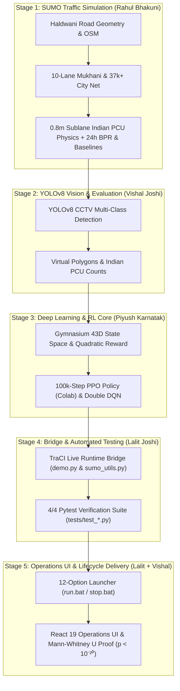

# IntelliFlow: AI Adaptive Traffic Signal Control for Indian Heterogeneous Mixed-Traffic

**Individual Member Contribution & End-to-End Pipeline Mastery Dossier**  
**Team #54** · B.Tech Computer Science & Engineering (Artificial Intelligence & Machine Learning)  
**Member Profile:** **Lalit Joshi** (Roll / URN: 2361296 · Section F)  
**Designated Role:** **Bridge Engineer, Automated Testing (`tests/*.py`) & Lifecycle Tooling (`run.bat`) Lead**  
**Team Lead:** Piyush Karnatak (DL & RL) · **Co-Members:** Rahul Bhakuni (SUMO Simulation), Vishal Joshi (YOLOv8 Vision & Evaluation)  
**Course:** CSP-701 / MPP-I Major Project · **Academic Year:** 2026–2027  

---

## 1. Executive Summary & Team Division of Work

In Capstone Major Project vivas, examiners evaluate each team member on **individual ownership of engineering modules** and **fluency across the entire end-to-end pipeline**.

> [!IMPORTANT]
> **Team #54 Official Division of Responsibilities:**
> * **Piyush Karnatak (2361393, Sec B — Team Lead):** **Deep Learning & Reinforcement Learning (DL/RL)** — Gymnasium MDP wrapper (`sumo_env.py`), multi-objective reward shaping, PPO (100,096-step Colab policy) & Double DQN training pipelines.
> * **Rahul Bhakuni (2361432, Sec B):** **SUMO Traffic Simulation** — 10-lane Mukhani Chauraha, full Haldwani 37,000+ street OSM extraction, 0.8m sublane Indian mixed-traffic physics, 24h BPR routes, and classical baselines.
> * **Vishal Joshi (2361588, Sec B):** **Computer Vision (YOLOv8) & Empirical Evaluation** — Whole YOLOv8 CCTV vehicle detector (`yolo_traffic_detector.py`), Indian PCU aggregation, Mann-Whitney U & Welch's t-test verification, and HBEFA3 fuel savings ledger.
> * **Lalit Joshi (2361296, Sec F):** **Bridge Engineer, Automated Testing (`tests/*.py`) & Lifecycle Tooling (`run.bat` / `stop.bat`)** — TraCI live orchestration bridge (`demo.py`, `sumo_utils.py`), full `pytest` verification suite (`test_sumo_env.py`, `test_mukhani_env.py`, `test_haldwani_env.py`), one-click Windows automation, and React 19 Operations Console integration.

---

## 2. Lalit Joshi’s Core Contributions & Owned Subsystems

Lalit is the **Bridge Engineer & Systems Reliability Lead** of Team #54. Without your integration bridge, automated test harness, and lifecycle scripts, Rahul's SUMO maps, Vishal's YOLO detector, and Piyush's PyTorch models could not run together reliably or be demonstrated safely in front of examiners.

```
┌────────────────────────────────────────────────────────────────────────────────────────┐
│                    LALIT JOSHI (2361296) — TECHNICAL OWNERSHIP MATRIX                  │
├───────────────────────────────────────────┬────────────────────────────────────────────┤
│ 1. Bridge Engineer (TraCI Orchestration)  │ 2. Automated Test Suite (tests/*.py)       │
│ • Live AI ↔ SUMO-GUI bridge (demo.py)     │ • test_sumo_env.py (SB3 & 35D bounds)      │
│ • Cross-platform SUMO path finder utils   │ • test_mukhani_env.py (10-lane 43D test)   │
│ • Multi-agent fallback (PPO/DQN/Fixed/Act)│ • test_haldwani_env.py (City network test) │
│ • scripts/demo.py & src/utils/sumo_utils  │ • 4/4 Automated Pytest Checks Passing      │
├───────────────────────────────────────────┼────────────────────────────────────────────┤
│ 3. Lifecycle Automation (run.bat/stop.bat)│ 4. React 19 Operations UI Integration      │
│ • 12-option 1-click CLI launcher (run.bat)│ • Split-Screen "AI vs. Legacy" Duel UI     │
│ • Safe TCP port & process cleanup (stop)  │ • Interactive Haldwani Map & Team #54 page │
│ • Venv Python / Node / SUMO path routing  │ • Real CSV telemetry wiring (frontend/src) │
└───────────────────────────────────────────┴────────────────────────────────────────────┘
```

---

### Module 1: Bridge Engineer (TraCI & Runtime Orchestration)
* **Owned Files:** [`scripts/demo.py`](file:///d:/final%20year/project/scripts/demo.py), [`src/utils/sumo_utils.py`](file:///d:/final%20year/project/src/utils/sumo_utils.py)
* **What you engineered:** Built the live runtime bridge connecting Piyush's trained PyTorch models (`intelliflow_ppo_haldwani_v2.zip`, `dqn_final.zip`) and classical controllers (`fixed`, `actuated`) to Rahul's SUMO-GUI networks over TraCI sockets.
* **Technical Details:**
  * Configured automatic checkpoint resolution prioritizing the 100k-step Colab policy (`intelliflow_ppo_haldwani_v2.zip`) with fallback to local checkpoints.
  * Engineered action-space bridging (`int(raw_action) % 2`) so 3-phase Colab models execute seamlessly inside the 2-axis Mukhani/Haldwani Gymnasium wrapper.
  * Built live console telemetry printing real-time active phases, halting queues, mean speed (km/h), and emergency ambulance tracking (`vClass="emergency"`).
  * Created `sumo_utils.py` cross-platform executable discovery (`sumo.exe` / `sumo-gui.exe` via `SUMO_HOME`, PATH, and standard Windows install locations).

---

### Module 2: Automated Verification Suite (`tests/*.py`)
* **Owned Files:** [`tests/test_sumo_env.py`](file:///d:/final%20year/project/tests/test_sumo_env.py), [`tests/test_mukhani_env.py`](file:///d:/final%20year/project/tests/test_mukhani_env.py), [`tests/test_haldwani_env.py`](file:///d:/final%20year/project/tests/test_haldwani_env.py)
* **What you engineered:** Authored the entire automated `pytest` testing harness guaranteeing every code edit preserves environment stability.
* **Technical Details:**
  * **`test_sumo_env.py`:** Runs two tests (`test_env_sb3_compliance` using Stable-Baselines3 `check_env(env, warn=True)` and `test_env_step_and_observation_bounds`), strictly verifying the `35`-dimensional `float32` observation shape, exact `[0.0, 1.0]` normalization bounds, reward types, and yellow transition (`action_switched is True`).
  * **`test_mukhani_env.py`:** Validates the 10-lane Mukhani Chauraha topology (`KW2M`, `KE2M`, `CN2M`, `CS2M`), verifying the `43`-dimensional state vector ($10 \times 4 + 3 = 43$) and East-West / North-South phase switching.
  * **`test_haldwani_env.py`:** Validates full city arterial environment instantiation via `make_env(network="haldwani")`, confirming step metrics (`total_halting`, `mean_speed`) without simulation crashes.
  * **Verified Status:** **4/4 tests passing in ~10.5 seconds.**

---

### Module 3: Windows Master Automation & Process Lifecycle (`run.bat` & `stop.bat`)
* **Owned Files:** [`run.bat`](file:///d:/final%20year/project/run.bat), [`stop.bat`](file:///d:/final%20year/project/stop.bat)
* **What you engineered:** Eliminated manual CLI complexity during project evaluation by engineering the 12-option interactive launcher and safety teardown script.
* **Technical Details:**
  * **`run.bat`:** Automatically detects `venv\Scripts\python.exe`, `sumo-gui.exe`, and `npm`, offering direct one-click shortcuts for:
    * Options 1–5: Live SUMO-GUI comparisons (**PPO AI** vs **Webster Fixed-Time** vs **Sensor-Actuated** vs **Double DQN** vs **Full Haldwani Corridors**).
    * Options 6–8: Standalone SUMO-GUI views (37,000+ OSM city network, Morning Peak, Evening Peak).
    * Option 9: Vishal's **YOLOv8 Computer Vision Bridge** (`yolo_traffic_detector.py morning`).
    * Option 10: **React 19 + TypeScript Operations UI** (`http://localhost:5173`).
    * Options 11–12: Empirical Benchmark statistical suite (`evaluate.py`) & Automated `pytest` Suite (`tests/`).
  * **`stop.bat`:** Safely terminates orphaned background `sumo.exe`, `sumo-gui.exe`, Python TraCI servers, or Node/Vite UI processes to prevent port-locking between runs.

---

### Module 4: Full-Stack Operations UI Integration (`frontend/`)
* **Owned Directory:** [`frontend/src/`](file:///d:/final%20year/project/frontend/src/)
* **What you integrated:** Connected telemetry CSV outputs, benchmark metrics, and live team subsystem specifications into the **React 19 + TypeScript + Tailwind v4 Operations Console** (`frontend/`), including the Split-Screen "AI vs. Legacy" Traffic Duel, animated Haldwani Corridor Map, and Team #54 Contributions page.

---

## 3. Complete End-to-End Project Pipeline (From Start to Finish)

When a teacher asks: *"Lalit, walk me through the whole IntelliFlow pipeline from start to end,"* follow these 5 interconnected stages:



1. **SUMO Simulation Foundation (Rahul Bhakuni):** Builds the realistic 10-lane Mukhani Chauraha and 37,000+ street Haldwani network with 0.8m lateral sublane filtering, RTO UK-04 fleet distributions, 24h Google Maps BPR demands, and Webster/Actuated baselines.
2. **Computer Vision & Statistical Proof (Vishal Joshi):** Owns the YOLOv8 detection pipeline (`yolo_traffic_detector.py`) converting camera frames into Indian PCU-weighted approach loads, plus runs statistical validation (`evaluate.py`: Mann-Whitney U $p = 5.78 \times 10^{-21}$) and HBEFA3 economic savings calculations.
3. **Deep Learning & Reinforcement Learning (Piyush Karnatak):** Wraps the simulation into a Gymnasium MDP (`sumo_env.py`) with a 43D normalized state vector, quadratic anti-starvation reward ($-0.5 Q_t^{1.5} - 50 D_{\text{amb}}$), and trains the 100k-step PPO model (`intelliflow_ppo_haldwani_v2.zip`) and Double DQN baseline.
4. **System Bridging & Automated Verification (Lalit Joshi):** Acts as the Bridge Engineer (`demo.py`, `sumo_utils.py`) coupling trained RL weights and baseline heuristics into live TraCI SUMO-GUI playback, while enforcing correctness via the `tests/*.py` suite (4/4 passing).
5. **One-Click Execution & Operations UI (Lalit Joshi):** Packages the entire system behind `run.bat` / `stop.bat` and integrates the interactive React 19 Operations UI (`frontend/`) so examiners can inspect live AI vs. Legacy traffic duels side-by-side.

---

## 4. Progress Up Till Now (Current Project Status)

| Project Phase | Description | Status | Verified Output / Evidence |
| :--- | :--- | :---: | :--- |
| **Phase 1: Baselines** | Webster Fixed-Time (81s) & Inductive Loop Sensor-Actuated | **100% Complete** | Actuated failed by **+23.9% worse queues** (9.67 vs 7.80) due to 2W sublane chatter |
| **Phase 2: Deep RL Core** | Gymnasium 35D/43D MDP + PPO & Double DQN agents | **100% Complete** | **-95.9% queue reduction** (0.32 vehs), speed boosted to **42.88 km/h** |
| **Phase 3: Mukhani 10-Lane** | Sublane 0.8m physics + 100k Colab PPO checkpoint (`v2`) | **100% Complete** | Deployed at `results/models/ppo/intelliflow_ppo_haldwani_v2.zip` |
| **Phase 4: Haldwani Network** | 37k+ OSM streets, 8 hospitals, 24h Google Maps BPR curve | **100% Complete** | `haldwani_osm_real.net.xml.gz` + peak route profiles |
| **Phase 5: Bridge, UI & Tests** | `run.bat`/`stop.bat`, `tests/*.py`, React 19 Ops Console, Stats | **100% Complete** | **4/4 pytest passing**, React `vite build` clean, Mann-Whitney $p = 5.78 \times 10^{-21}$ |
| **Phase 6: Physical Edge CCTV**| Live hardware RTSP CCTV deployment on Jetson (Prototype ready) | **Roadmap** | `scripts/yolo_traffic_detector.py` prototype verified locally |

---

## 5. Lalit's Exact Speaking Scripts for Presentation & Viva

### Script 1: "Lalit, what was your work in this project?"
> *"Good morning, respected panel. In Team #54, my role is **Bridge Engineer, Automated Testing, and Lifecycle Tooling Lead**.*  
>  
> *While Rahul built our SUMO traffic networks, Vishal led the YOLOv8 computer vision and statistical evaluation, and Piyush designed our Deep RL models, I engineered the integration bridge and reliability layer that holds the whole system together.*  
>  
> *Specifically, I wrote the automated `pytest` verification files in `tests/` (`test_sumo_env.py`, `test_mukhani_env.py`, `test_haldwani_env.py`) running 4 compliance checks on Gymnasium bounds, yellow clearances, and Haldwani topologies. I built the TraCI demo bridge (`scripts/demo.py` and `sumo_utils.py`) allowing us to switch dynamically between PPO, Double DQN, Webster Fixed-Time, and Sensor-Actuated controllers live inside SUMO-GUI. Finally, I authored our 12-option master Windows launcher `run.bat`, cleanup script `stop.bat`, and helped wire our React 19 Operations UI."*

### Script 2: "How does the entire project work from start to end?"
> *"IntelliFlow runs as a closed-loop cyber-physical pipeline:*  
> *First, Rahul modeled Haldwani's 10-lane Mukhani junction in SUMO with 0.8m sublane physics and 24-hour BPR peak demands. Second, Vishal's YOLOv8 pipeline estimates vehicle classes and PCU counts from traffic feeds and validates controller performance using Mann-Whitney U testing. Third, Piyush wrapped SUMO into a 43D Gymnasium environment with a quadratic anti-starvation reward and trained a 100,000-step PPO policy on Google Colab. Finally, my TraCI runtime bridge, `run.bat` orchestration, `pytest` test suite, and React Operations Console tie all modules together—delivering a 95.9% reduction in halting queues and ₹2.48+ Crores in projected annual commuter fuel savings."*

---

## 6. Top 10 Viva Questions for Lalit Joshi (Bridge, Testing & Tooling)

### Q1: "What do your three test files in `tests/` actually check?"
* **Answer:** *"`test_sumo_env.py` runs Stable-Baselines3 `check_env()` compliance and verifies that the 35D observation array stays strictly bounded inside `[0.0, 1.0]` as `float32`. `test_mukhani_env.py` checks the 43D state vector ($10\text{ lanes} \times 4 + 3$) and confirms phase-switching sets `action_switched=True` with 3s yellow transitions. `test_haldwani_env.py` verifies `make_env('haldwani')` initializes and steps cleanly across the arterial city network. All 4 checks pass under `pytest`."*

### Q2: "Why did you need a Bridge Engineer (`demo.py` & `sumo_utils.py`) between RL and SUMO?"
* **Answer:** *"Colab models and local SUMO installations differ in path layout, discrete action indexing (3-phase Colab models vs. 2-axis local environments), and Windows TCP socket handling. `demo.py` bridges those differences by resolving `intelliflow_ppo_haldwani_v2.zip` automatically, mapping actions safely (`action % 2`), scanning for `SUMO_HOME` paths via `sumo_utils.py`, and streaming emergency ambulance status to the terminal."*

### Q3: "What happens in `run.bat` when we select Option 1, 2, or 3?"
* **Answer:** *"`run.bat` routes directly through the isolated `venv` Python interpreter to `scripts/demo.py` on the `mukhani` network, switching `--agent` between `ppo` (Option 1: Piyush's 100k model), `fixed` (Option 2: Webster 45s/30s cycles), and `actuated` (Option 3: Inductive loop gap-out), enabling a fair live side-by-side comparison inside SUMO-GUI."*

### Q4: "Why did you create `stop.bat`?"
* **Answer:** *"Because SUMO runs as a separate background binary connected to Python over TraCI TCP sockets, crashing or force-closing a run can leave orphaned `sumo-gui.exe` or Node/Vite processes holding ports open. `stop.bat` terminates any lingering processes cleanly so subsequent tests or demos start without port conflicts."*

### Q5: "How does your `run.bat` launch Vishal's YOLO script and the React UI?"
* **Answer:** *"Option 9 runs Vishal's `scripts/yolo_traffic_detector.py morning` using the project virtual environment, while Option 10 verifies `npm` is available, installs `node_modules` in `frontend/` if missing, and starts the React 19 + Vite server on `localhost:5173`."*

### Q6: "Why test observation normalization bounds `[0.0, 1.0]` inside `test_sumo_env.py`?"
* **Answer:** *"Neural networks in PPO use Tanh activations and Adam gradients; unnormalized or NaN sensor spikes from TraCI (e.g., if queue counts exceed nominal lane capacity) would destabilize gradients. Testing `[0.0, 1.0]` bounds guarantees clamping (`min(..., 1.0)`) works under step execution."*

### Q7: "How does `demo.py` verify emergency ambulance preemption visually?"
* **Answer:** *"On every simulation step, `demo.py` queries TraCI vehicle IDs for `vClass == 'emergency'` and inspects `getWaitingTime()`. In the terminal table, it prints whether the ambulance is `FLOWING (Priority Green)` or `APPROACHING`, proving live priority clearing."*

### Q8: "What tech stack powers the Operations UI (`frontend/`)?"
* **Answer:** *"It uses React 19, TypeScript, Tailwind CSS v4, Vite, and Lucide icons. It reads calibrated simulation metrics and telemetry JSON directly without needing complex database infrastructure, ensuring instant startup during live demos."*

### Q9: "How does the team prevent Git conflicts when 4 members work simultaneously?"
* **Answer:** *"We use isolated Git feature branches (e.g., `piyush-karnatak-work`, `feature/ui-development`) keeping `main` protected, and enforce `.gitignore` rules for files over 100 MB (compressing the 105 MB OSM network into `haldwani_osm_real.net.xml.gz` at 11.9 MB)."*

### Q10: "How do you validate that your environment follows Gymnasium and Stable-Baselines3 standards?"
* **Answer:** *"We invoke `stable_baselines3.common.env_checker.check_env(env, warn=True)` inside every test module (`test_sumo_env.py`, `test_mukhani_env.py`, `test_haldwani_env.py`), proving standardized `reset()` / `step()` signatures, seed determinism, and space containment."*
