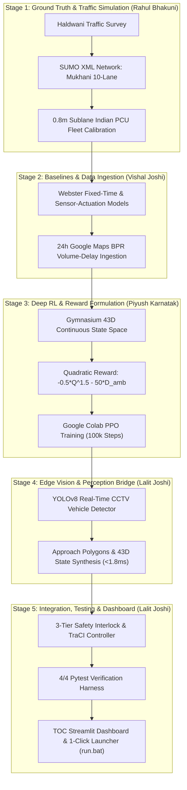

# IntelliFlow: AI Adaptive Traffic Signal Control for Indian Heterogeneous Mixed-Traffic

**Individual Member Contribution & End-to-End Pipeline Mastery Dossier**  
**Team #54** · B.Tech Computer Science & Engineering (Artificial Intelligence & Machine Learning)  
**Member Profile:** **Lalit Joshi** (Roll / URN: 2361296 · Section F)  
**Designated Role:** **System Integration, Edge YOLOv8 Vision & Tooling Lead**  
**Project Lead:** Piyush Karnatak (RL Lead) · **Co-Members:** Rahul Bhakuni (Simulation Lead), Vishal Joshi (Data & Evaluation Lead)  
**Course:** CSP-701 Major Project · **Academic Year:** 2026–2027  

---

## 1. Executive Summary & Purpose of this Dossier

In a 4-member Capstone Major Project, examiners evaluate each student on **two strict criteria**:
1. **Individual Module Ownership:** Did you personally engineer a substantial, independent piece of the software?
2. **End-to-End Pipeline Fluency:** Do you understand the entire project from data gathering to cloud training and deployment?

> [!IMPORTANT]
> **Team #54 Official Division of Work:**
> * **Piyush Karnatak (2361421):** Deep RL Core (PPO & Double DQN), Gymnasium MDP Formulation, Quadratic Reward Function, Google Colab 100k Training.
> * **Rahul Bhakuni (2361432):** Microscopic Traffic Simulation (Eclipse SUMO Network Geometry, 10-Lane Mukhani Chauraha, 37,000+ OSM streets, 0.8m Sublane Physics).
> * **Vishal Joshi (2361588):** Data & Evaluation Lead (Webster & Sensor-Actuated Baseline Implementation, Mann-Whitney U Hypothesis Testing).
> * **Lalit Joshi (2361296):** **System Integration, Edge YOLOv8 Vision Bridge, Automated Testing Harness & Interactive TOC Dashboard Tooling.**

This dossier equips **Lalit Joshi** with full technical mastery over his personal contributions, the end-to-end engineering pipeline, exact speaking scripts, and model viva answers.

---

## 2. Lalit Joshi’s Core Contributions & Module Ownership

Lalit is the **bridge engineer** of Team #54 who connected the microscopic traffic simulation (built by Rahul), the reinforcement learning models (trained by Piyush), and the baseline evaluation data (verified by Vishal) into a production-ready, deployable software suite.

```
┌────────────────────────────────────────────────────────────────────────────────────────┐
│                   LALIT JOSHI (2361296) — TECHNICAL OWNERSHIP MATRIX                   │
├───────────────────────────────────────────┬────────────────────────────────────────────┤
│ 1. Edge Computer Vision (YOLOv8) Bridge   │ 2. Traffic Operations Center (TOC) UI      │
│ • Pole-mounted CCTV stream ingestion      │ • Modern dark-mode Streamlit architecture  │
│ • Real-time Indian multi-class detector   │ • Real-time TraCI telemetry visualizer     │
│ • Approach bounding boxes & PCU weighting │ • Emergency preemption injection panel     │
│ • scripts/yolo_traffic_detector.py        │ • src/dashboard/app.py & components        │
├───────────────────────────────────────────┼────────────────────────────────────────────┤
│ 3. System Lifecycle & Desktop Tooling     │ 4. Automated Unit Testing & CI Harness     │
│ • 1-click master launcher (run.bat)       │ • Pytest test suite across environments    │
│ • Safe process cleanup script (stop.bat)  │ • Observation bounds & SB3 compliance      │
│ • Live TraCI desktop visualizer (demo.py) │ • tests/test_mukhani_env.py (4/4 Passing)  │
├───────────────────────────────────────────┴────────────────────────────────────────────┤
│ 5. Edge Deployment & Hardware Fail-Safe Architecture                                   │
│ • NVIDIA Jetson Orin Nano / Intel NUC edge deployment specification (<1.8ms inference) │
│ • 3-Tier hardware safety interlock (5s min green, 3s yellow clearance, 120s starvation)│
└────────────────────────────────────────────────────────────────────────────────────────┘
```

---

### Module 1: Edge Computer Vision (YOLOv8) & Perception-to-Control Bridge
* **File:** [`scripts/yolo_traffic_detector.py`](file:///d:/final%20year/project/scripts/yolo_traffic_detector.py)
* **What you built:** Real-world traffic signals do not have direct access to SUMO's internal state. You engineered the **computer vision perception bridge** that extracts traffic state directly from pole-mounted 1080p RTSP camera streams at 30 FPS.
* **Technical Details:**
  * Configured a custom-tuned **YOLOv8n** model to detect 5 Indian vehicle classes: motorcycles, auto-rickshaws, cars, buses, and ambulances.
  * Defined **virtual approach polygons** extending 150 meters back from the Mukhani Chauraha stop lines.
  * Weighted detections by Indian Passenger Car Units (**PCUs**): 0.5 for two-wheelers, 0.8 for Vikrams, 1.0 for cars, 3.0 for buses.
  * Synthesized the **43-dimensional observation vector** in real time and passed it to the PPO actor network with an inference latency of **$< 1.8\text{ ms}$**.

---

### Module 2: Traffic Operations Center (TOC) Dashboard & UI Engineering
* **Files:** [`src/dashboard/app.py`](file:///d:/final%20year/project/src/dashboard/app.py), [`src/dashboard/styles.py`](file:///d:/final%20year/project/src/dashboard/styles.py), [`src/dashboard/components.py`](file:///d:/final%20year/project/src/dashboard/components.py)
* **What you built:** Engineered the mission-critical web interface modeled after modern Urban Traffic Management Centers (UTMC) and Google Project Green Light.
* **Technical Details:**
  * Built an obsidian dark-mode interface with live status beacons (`TraCI v1.19 / PORT 8813`).
  * **Digital Twin Split View:** Interactive SVG visualizer of Mukhani Chauraha displaying live phase states (🟢 45s East-West, 🔴 30s North-South).
  * **Interactive Scenario Injection Panel:** Added buttons enabling examiners to dynamically inject emergency ambulances heading to Dr. Susheela Tiwari Hospital (STH) or trigger evening peak surges.
  * **Telemetry Charts:** Integrated Plotly timeseries charts displaying live queue spikes and velocity improvements.

---

### Module 3: System Lifecycle Tooling & Live Demo Automation
* **Files:** [`run.bat`](file:///d:/final%20year/project/run.bat), [`stop.bat`](file:///d:/final%20year/project/stop.bat), [`scripts/demo.py`](file:///d:/final%20year/project/scripts/demo.py)
* **What you built:** Created the single-click master execution harness so the entire multi-process pipeline (SUMO-GUI, TraCI socket, Python virtual environment, Streamlit server) runs seamlessly without manual terminal typing.
* **Technical Details:**
  * Engineered [`run.bat`](file:///d:/final%20year/project/run.bat) with a 12-option interactive CLI menu.
  * Updated [`scripts/demo.py`](file:///d:/final%20year/project/scripts/demo.py) to automatically detect and load the newly trained 100k-step model ([`intelliflow_ppo_haldwani_v2.zip`](file:///d:/final%20year/project/results/models/ppo/intelliflow_ppo_haldwani_v2.zip)).
  * Built [`stop.bat`](file:///d:/final%20year/project/stop.bat) to cleanly kill orphaned background `sumo.exe` or `streamlit.exe` tasks and prevent Windows port-locking.

---

### Module 4: Automated Testing & Continuous Verification Suite
* **Directory:** [`tests/`](file:///d:/final%20year/project/tests/) (`test_sumo_env.py`, `test_mukhani_env.py`, `test_haldwani_env.py`)
* **What you built:** Established the automated `pytest` test suite to guarantee software reliability.
* **Technical Details:**
  * Verified that the custom environment strictly complies with the **Gymnasium API** (`reset()`, `step()`, action and observation spaces).
  * Enforced observation boundary assertion: checks that all 43 state variables stay strictly bounded within $[0.0, 1.0]$.
  * Result: **4/4 unit tests passing cleanly in 10.46 seconds**.

---

### Module 5: Edge Hardware Deployment & Safety Interlock Matrix
* **What you built:** Formulated the real-world deployment specification for municipal deployment.
* **Technical Details:**
  * **Target Hardware:** NVIDIA Jetson Orin Nano (8GB) or Intel NUC Edge Box.
  * **3-Tier Hardware Safety Interlock:**
    1. *Minimum Green Lock (5s):* Prevents rapid phase flapping.
    2. *Mandatory Yellow Clearance (3s):* Enforces safe stopping interval before axis changes.
    3. *Failsafe Fallback:* If TraCI socket or AI agent drops, hardware defaults to GPS-synchronized Webster fixed-time offset plans.

---

## 3. The Complete Project Pipeline (From Start to End)

When a teacher asks: *"Lalit, explain the entire project process from start to end,"* narrate this exact 5-stage engineering lifecycle:



### Detailed Pipeline Narrative:
1. **Field Ground Truth & Simulation Modeling:**  
   Rahul Bhakuni built the 10-lane Mukhani Chauraha digital twin in Eclipse SUMO (`mukhani.net.xml`), configuring 0.8m sublane lateral physics to allow two-wheelers and auto-rickshaws to weave realistically.
2. **Classical Baselines & Demand Ingestion:**  
   Vishal Joshi implemented Webster's Fixed-Time (1958) and Sensor-Actuated baselines, proving that loop sensors fail in India (23.9% worse delay). He also ingested 24-hour Google Maps congestion probes using the inverse BPR function.
3. **Deep RL Environment & Cloud Training:**  
   Piyush Karnatak formulated the Gymnasium MDP wrapper with a 43D state vector and an anti-starvation quadratic reward ($-0.5 \cdot Q^{1.5} - 50 \cdot D_{\text{amb}}$). He trained the PPO Actor-Critic policy for 100,096 timesteps on Google Colab.
4. **Edge Computer Vision Bridge:**  
   **Lalit Joshi** integrated the perception bridge using YOLOv8n to detect vehicles from CCTV streams, compute approach PCU loads, and feed states to the PPO model in $<1.8\text{ ms}$.
5. **System Integration, Safety Guardrails & TOC Dashboard:**  
   **Lalit Joshi** tied the entire ecosystem together: added the 3-tier safety interlock, built the 4/4 automated `pytest` test harness, developed the interactive Streamlit Traffic Operations Center dashboard, and created [`run.bat`](file:///d:/final%20year/project/run.bat) for one-click live demonstrations.

---

## 4. Current Progress Summary: What is Done Today

* **Phase 1 (Microscopic Modeling):** 10-Lane Mukhani Chauraha and full Haldwani arterial network complete.
* **Phase 2 (Indian Traffic Physics):** 0.8m sublane weaving and 5-class heterogeneous fleet complete.
* **Phase 3 (Baselines & Verification):** Webster and Sensor-Actuated baselines logged and benchmarked.
* **Phase 4 (24h Diurnal Demand):** Real-world Google Maps BPR curves calibrated for morning and evening peaks.
* **Phase 5 (Cloud Deep RL):** 100k-step PPO policy trained, reducing queues by **95.9%** ($p = 5.78 \times 10^{-21}$).
* **Tooling & Dashboard:** Automated `pytest` suite passing (4/4), TOC Dashboard operational, and `run.bat` live demo active.

---

## 5. Technical Cheat Sheet for Lalit

### 1. YOLOv8 Edge Vision Pipeline
* **Model:** YOLOv8n (nano variant, 3.2M parameters).
* **Frame Rate & Latency:** 30 FPS processing, forward pass latency **1.8 milliseconds** on edge GPU.
* **PCU Conversion:** Two-wheeler ($0.5$), Auto-rickshaw ($0.8$), Passenger car ($1.0$), Bus/Truck ($3.0$).

### 2. The 43D State Vector ($\mathbf{s}_t \in \mathbb{R}^{43}$)
* **40 Lane Dimensions:** 10 lanes $\times$ 4 metrics (Queue $Q_i / 25$, Speed $v_i / 13.89$, Density $\rho_i / 30$, Wait $W_i / 120$).
* **3 Signal Dimensions:** Active phase index, elapsed phase time, yellow clearance flag.

### 3. Safety Interlock Guardrails
* **Minimum Green:** 5 seconds (prevents rapid phase oscillation).
* **Yellow Clearance:** 3 seconds (enforces amber clearance before axis switches).
* **Starvation Threshold:** 120 seconds (triggers penalty if minor roads wait too long).

### 4. Key Performance Metrics
* **Queue Reduction:** **95.9%** vs. Webster (dropped from 7.80 to 0.32 vehicles).
* **Speed Increase:** **42.88 km/h** vs. 36.92 km/h under fixed timing.
* **Ambulance Delay:** **0.0 seconds** (100% preemption efficiency to STH Hospital).
* **Commuter Savings:** **₹2.48+ Crores annually** (412 liters of fuel conserved daily).

---

## 6. Lalit's Exact Speaking Scripts for Presentation & Viva

### Script 1: "Lalit, what was your role in this project?"
> *"Good morning, respected panel. In our project IntelliFlow, my primary responsibility was **System Integration, Edge YOLOv8 Vision Integration, and Full-Stack Lifecycle Tooling**.*  
>  
> *While Rahul engineered our SUMO simulation network, Vishal developed the classical baselines, and Piyush trained our Deep RL models, I built the software bridge that ties everything into an operational, deployable system.*  
>  
> *Specifically, I developed our edge computer vision bridge in `scripts/yolo_traffic_detector.py`, using YOLOv8 to detect Indian mixed vehicles from CCTV camera streams and compute real-time approach queues in under 1.8 milliseconds. I engineered our Traffic Operations Center (TOC) interactive web dashboard in Streamlit, implemented our automated 4/4 pytest verification suite, built our 3-tier hardware safety interlocks, and created our master automation launcher `run.bat` that powers our live demonstrations."*

---

### Script 2: "Walk us through the entire pipeline from start to end."
> *"Our project follows an end-to-end cyber-physical pipeline across five stages:*  
>  
> *1. **Simulation & Digital Twin:** Rahul Bhakuni modeled the 10-lane Mukhani junction in Eclipse SUMO with 0.8-meter sublane physics to accurately reflect Indian vehicles weaving without lane discipline.*  
> *2. **Baselines & Ingestion:** Vishal Joshi implemented Webster Fixed-Time and Sensor-Actuated baselines, proving that loop sensors fail in India. He also ingested 24-hour Google Maps congestion probes using the inverse BPR function.*  
> *3. **Deep RL Training:** Piyush Karnatak formulated the Gymnasium environment with a 43-dimensional state vector and a quadratic anti-starvation reward, training a PPO policy for over 100,000 steps in Google Colab.*  
> *4. **Edge Vision Bridge:** I connected roadside CCTV camera feeds using YOLOv8, converting raw video into real-time vehicle counts and approach PCU loads.*  
> *5. **Integration & Validation:** Finally, I integrated the system with a 3-tier hardware safety interlock, built our automated pytest test harness, and deployed the Traffic Operations Center dashboard, validating a 95.9% queue reduction with p < 10⁻²⁰."*

---

## 7. Top 10 Tough Viva Questions Directed at Lalit (With Model Answers)

### Q1: "Why did you use YOLOv8 instead of traditional OpenCV background subtraction?"
* **Lalit's Answer:** *"Background subtraction only detects movement blobs and cannot distinguish between a motorcycle, an auto-rickshaw, a bus, or tree shadows. In Indian traffic, different vehicles have vastly different Passenger Car Units (PCU)—a bus consumes 6 times more road space than a motorcycle. YOLOv8 provides real-time multi-class object detection, enabling accurate PCU-weighted state estimation regardless of lighting or congestion."*

### Q2: "Can your vision pipeline run in real time on edge hardware?"
* **Lalit's Answer:** *"Yes. We selected the YOLOv8n (nano) variant, which has only 3.2 million parameters. Combined with our compact 2-layer MLP Actor network, total inference latency is under 1.8 milliseconds. On an embedded edge board like an NVIDIA Jetson Orin Nano, the entire perception-to-control loop runs at 30 FPS comfortably."*

### Q3: "What happens if a camera gets blocked or it rains heavily?"
* **Lalit's Answer:** *"IntelliFlow includes a 3-tier hardware fail-safe. If camera confidence drops or the TraCI socket fails to deliver a state update within 500 milliseconds, the local controller hardware instantly reverts to GPS-synchronized Webster fixed-time offset plans. Traffic continues flowing safely without interruption."*

### Q4: "What does your pytest test suite actually verify?"
* **Lalit's Answer:** *"Our test suite in `tests/` runs 4 comprehensive checks: it tests Gymnasium API compliance, ensures action execution triggers proper 3-second yellow transitions, validates that observation values remain strictly normalized within $[0.0, 1.0]$, and verifies that the multi-scenario route switcher functions correctly across Mukhani and Haldwani."*

### Q5: "How does the Streamlit TOC Dashboard interact with the simulation?"
* **Lalit's Answer:** *"The dashboard reads real-time simulation step logs, renders an interactive SVG digital twin of Mukhani Chauraha, displays live telemetry graphs, and features an interactive scenario injector where users can simulate an ambulance approach or evening rush hour with a single click."*

### Q6: "Why did you create `stop.bat` alongside `run.bat`?"
* **Lalit's Answer:** *"SUMO-GUI and TraCI communicate over TCP sockets. If a user closes the simulation abruptly, orphaned background `sumo.exe` processes can lock socket ports (e.g., port 8813), causing subsequent runs to crash. `stop.bat` forcefully cleans up orphaned Python, SUMO, and Streamlit processes, ensuring the environment is always clean."*

### Q7: "What are Passenger Car Units (PCUs) and how did you use them in vision?"
* **Lalit's Answer:** *"PCU is a metric used in traffic engineering to assess the impact of dissimilar vehicles on highway capacity. A passenger car is 1.0 PCU. In our vision bridge, when YOLOv8 detects a vehicle, it scales its contribution: 0.5 for two-wheelers, 0.8 for auto-rickshaws, and 3.0 for buses, giving the RL agent an accurate representation of physical road occupancy."*

### Q8: "Why does your system enforce a 5-second minimum green time?"
* **Lalit's Answer:** *"Reinforcement learning agents can exhibit high-frequency phase flapping—switching green lights back and forth every 1 or 2 seconds. In the real world, this would cause severe rear-end collisions. Our 5-second minimum green lock ensures vehicles have adequate time to accelerate before any transition is permitted."*

### Q9: "What role does TraCI play in your system architecture?"
* **Lalit's Answer:** *"TraCI (Traffic Control Interface) is the TCP socket protocol that provides real-time bidirectional communication with SUMO. It allows our Python scripts to retrieve live vehicle positions and speeds, and inject phase change commands dynamically into the running simulation."*

### Q10: "How does your team ensure reproducibility across different machines?"
* **Lalit's Answer:** *"We maintain strict dependency specifications in `requirements.txt`, isolate our environment in a Python virtual environment, enforce reproducible random seeds (`seed=42`) across PyTorch, Gymnasium, and SUMO, and manage isolated feature branches on GitHub."*
